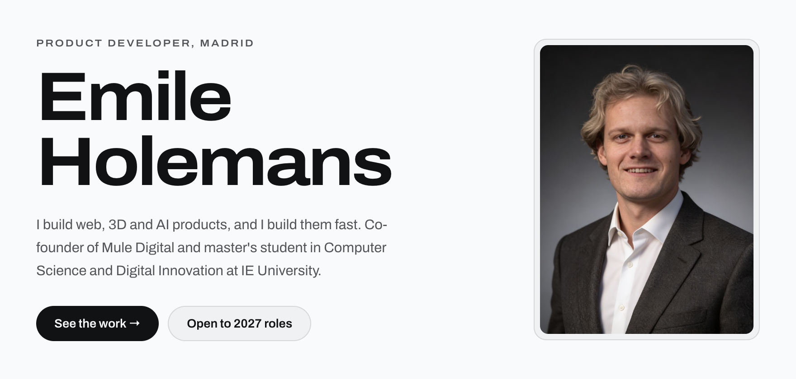
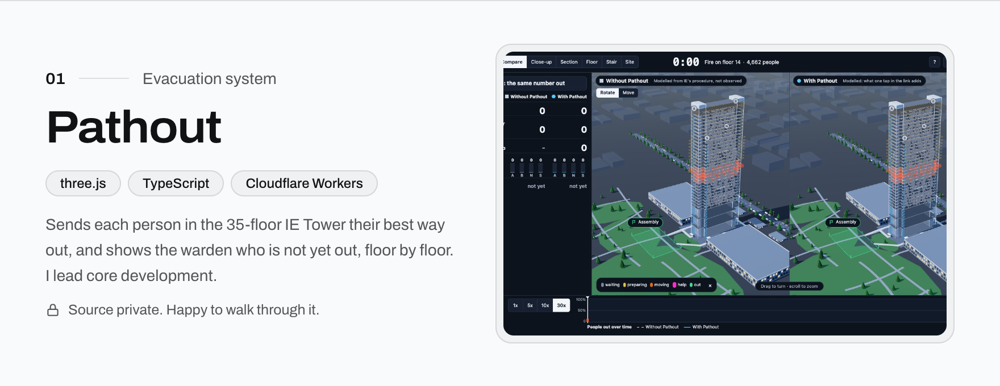
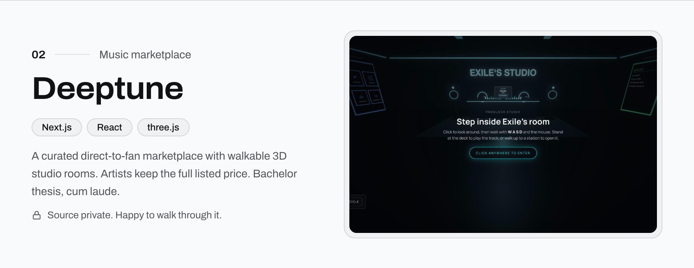
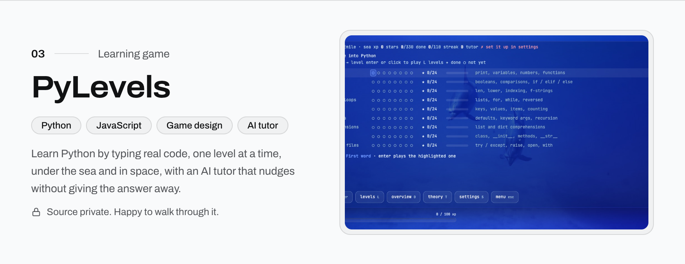
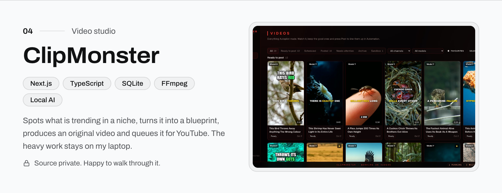
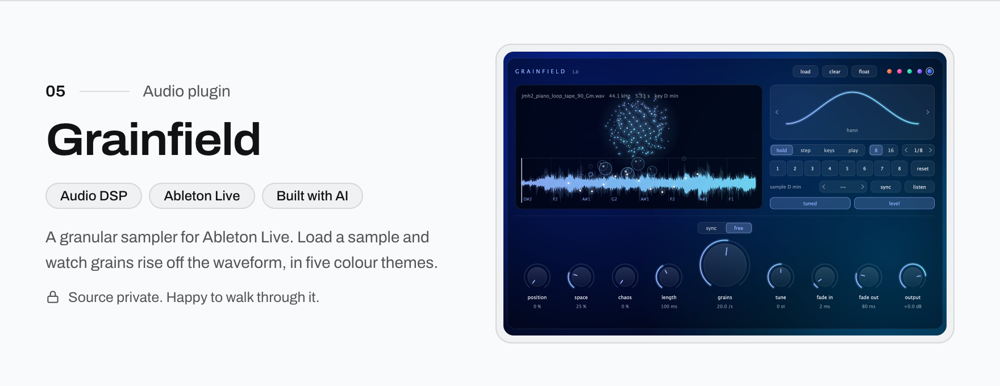
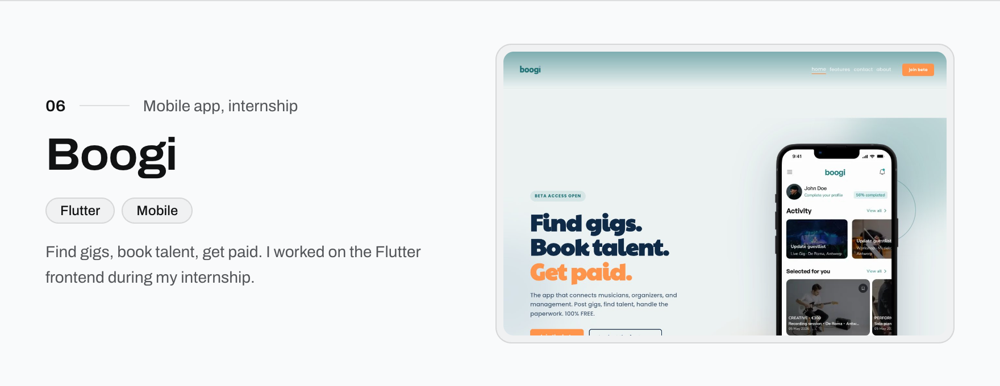
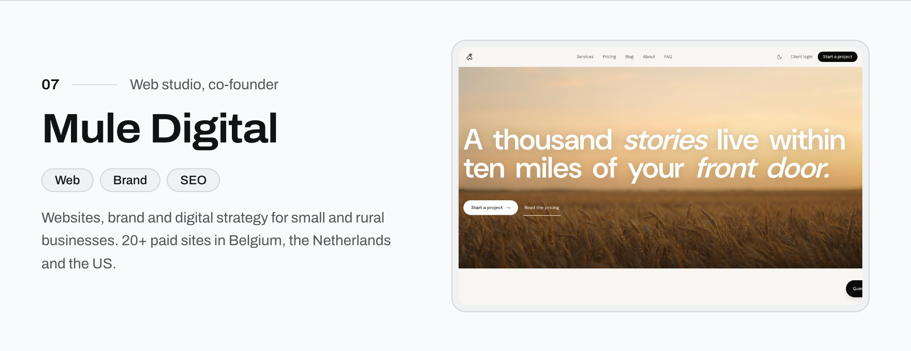
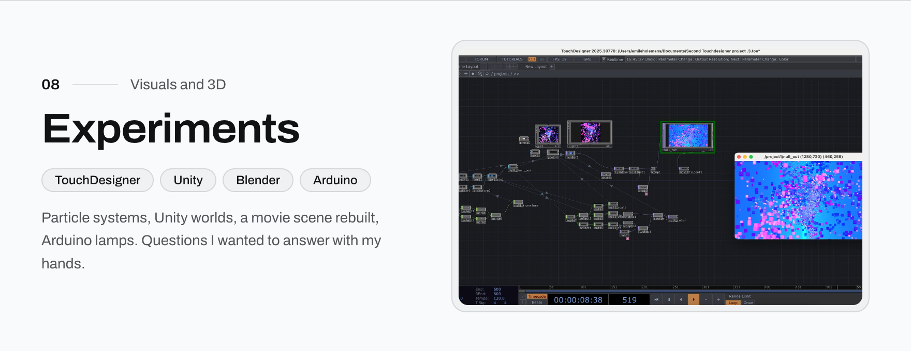
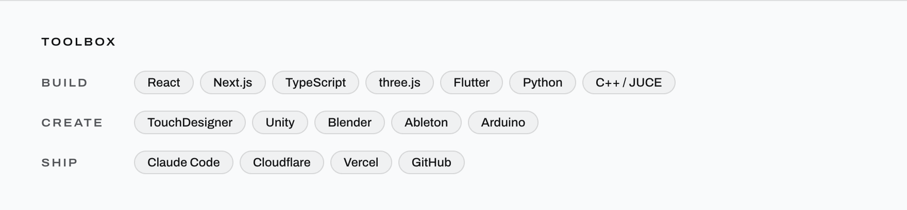

<a href="https://xcessiveemile.github.io"><picture><source media="(prefers-color-scheme: dark)" srcset="assets/cards/hero-dark.png"></picture></a>

  <a href="https://xcessiveemile.github.io">Portfolio</a> &nbsp;·&nbsp;
  <a href="https://xcessiveemile.github.io/projects">Work</a> &nbsp;·&nbsp;
  <a href="https://www.linkedin.com/in/emileholemans/">LinkedIn</a> &nbsp;·&nbsp;
  <a href="https://xcessiveemile.github.io/cv/Emile_Holemans_CV.pdf">CV</a>

<a href="https://xcessiveemile.github.io/projects#pathout"><picture><source media="(prefers-color-scheme: dark)" srcset="assets/cards/pathout-dark.png"></picture></a>

<a href="https://xcessiveemile.github.io/projects#pathout">see how it works ↗</a>

<b>How I built it</b>

- **The problem:** 4,662 people, 35 floors, four stairs. A fire drill sends everyone down the nearest stair, so some stairs jam while others stay empty.
- **My part:** I lead core development. I built the 3D simulation that evacuates the IE Tower twice, without and with Pathout, and the site that ties the simulation, the planner, Command and the phone together.
- **Simulation:** three.js in the browser. Each person is an agent with a reaction delay, walking speed and stair queue. The stair timings come from one stair we measured in the real tower (20.46 s per floor).
- **Planner:** a teammate's time-expanded network solved with A\*. It runs on the server inside a Cloudflare Worker, never in the visitor's browser.
- **Live system:** phones join through a link and confirm their floor. A Durable Object relay streams every tap to the Command dashboard and plans again when someone reports a stair as busy.
- **Result (default run):** everyone out in 23:23 with Pathout instead of 26:48.

<a href="https://xcessiveemile.github.io/projects#deeptune"><picture><source media="(prefers-color-scheme: dark)" srcset="assets/cards/deeptune-dark.png"></picture></a>

<a href="https://xcessiveemile.github.io/projects#deeptune">see how it works ↗</a>

<b>How I built it</b>

- **Started with people, not code:** interviews with independent artists and listeners. Artists wanted to keep their money and be picked by a person, not an algorithm.
- **Front end:** Next.js with React. Each release has a walkable 3D studio room built with three.js and React Three Fiber.
- **Back end:** Convex for the data and Clerk for accounts, so all the business logic runs on the server.
- **Curation flow:** artists apply, a person reviews, and accepted releases go live with the full listed price going to the artist.
- **Outcome:** a working MVP and my bachelor thesis, graded cum laude.

<a href="https://pylevels.pages.dev"><picture><source media="(prefers-color-scheme: dark)" srcset="assets/cards/pylevels-dark.png"></picture></a>

<a href="https://pylevels.pages.dev">play it ↗</a> &nbsp;·&nbsp; <a href="https://xcessiveemile.github.io/projects#pylevels">case study ↗</a>

<b>How I built it</b>

- **Why:** I am learning Python myself, so I built the tool I wanted: short levels where you type real code.
- **Python in the browser:** Pyodide runs real Python inside the page, so nothing is installed and nothing on your computer is touched.
- **Checking:** a level passes when your program prints exactly what it expects, with a clear message when it does not.
- **AI tutor:** pick Claude, your own free Gemini key, or a local model through Ollama. It sees your code and last run and nudges without giving the answer.
- **Free to play:** 72 lessons in nine worlds and 38 drills, plus a desktop version for Mac and Windows.

<a href="https://xcessiveemile.github.io/projects#clipmonster"><picture><source media="(prefers-color-scheme: dark)" srcset="assets/cards/clipmonster-dark.png"></picture></a>

<a href="https://xcessiveemile.github.io/projects#clipmonster">see how it works ↗</a>

<b>How I built it</b>

- **Runs on my own laptop:** a Next.js dashboard and a background worker, sharing a SQLite database through Drizzle.
- **Pipeline in packages:** trends → blueprint → generate → render → upload, each its own package in a monorepo.
- **Rendering:** FFmpeg for the video, whisper.cpp for captions.
- **Safety first:** every source must pass a licence check (Creative Commons or written permission), nothing is downloaded from YouTube or TikTok, and nothing uploads until I press Confirm, at most 3 a day.
- **YouTube:** the official Data API with OAuth, and tokens stored encrypted.

<a href="https://xcessiveemile.github.io/projects#grainfield"><picture><source media="(prefers-color-scheme: dark)" srcset="assets/cards/grainfield-dark.png"></picture></a>

<a href="https://xcessiveemile.github.io/projects#grainfield">case study ↗</a>

<a href="https://www.weareboogi.com/"><picture><source media="(prefers-color-scheme: dark)" srcset="assets/cards/boogi-dark.png"></picture></a>

<a href="https://www.weareboogi.com/">weareboogi.com ↗</a> &nbsp;·&nbsp; <a href="https://xcessiveemile.github.io/projects#boogi">case study ↗</a>

<a href="https://mule-digital.com"><picture><source media="(prefers-color-scheme: dark)" srcset="assets/cards/mule-dark.png"></picture></a>

<a href="https://mule-digital.com">mule-digital.com ↗</a>

<a href="https://xcessiveemile.github.io/projects#touchdesigner"><picture><source media="(prefers-color-scheme: dark)" srcset="assets/cards/experiments-dark.png"></picture></a>

<a href="https://xcessiveemile.github.io/projects#touchdesigner">TouchDesigner ↗</a> &nbsp;·&nbsp; <a href="https://xcessiveemile.github.io/projects#unity">Unity ↗</a> &nbsp;·&nbsp; <a href="https://xcessiveemile.github.io/projects#dragon-lamp">Dragon Lamp ↗</a>

<a href="https://xcessiveemile.github.io"><picture><source media="(prefers-color-scheme: dark)" srcset="assets/cards/toolbox-dark.png"></picture></a>

### How I work

I trained in **C#** and game development at KdG, and I am learning **Python** now. For the web stack (React, Next.js, TypeScript, three.js, Flutter) I work AI-first with Claude Code: I design the product, direct the build, read and test what comes out, and ship it. I say that openly because it is how I work best, and it is the job I want: taking AI from a demo to something people use.

Project code is kept private. Ask me for a walkthrough on <a href="https://www.linkedin.com/in/emileholemans/">LinkedIn</a>.

