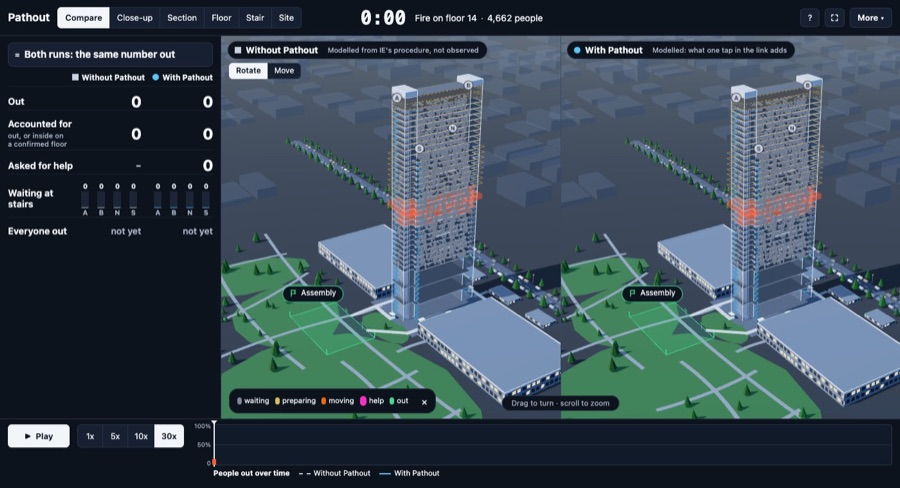
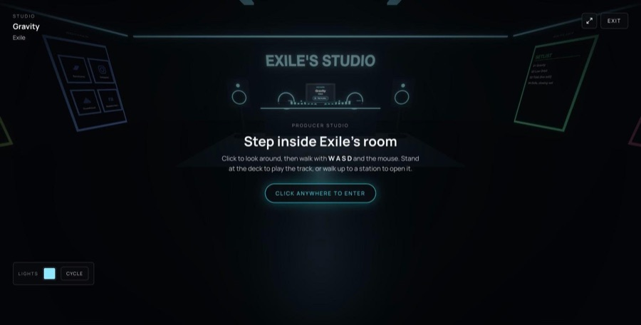
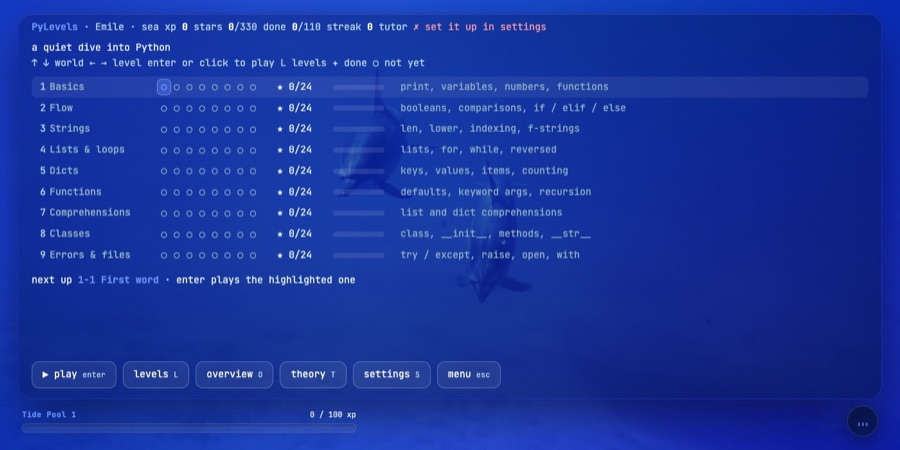
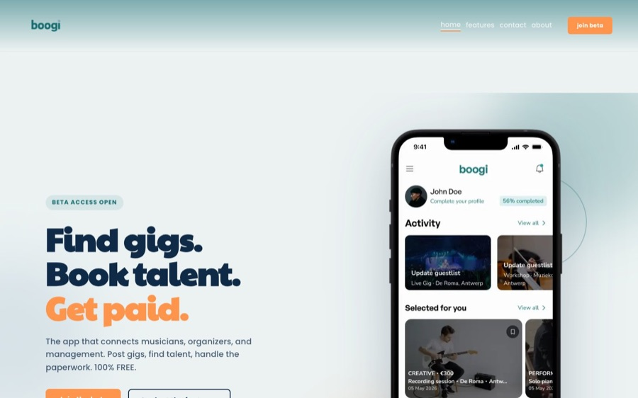
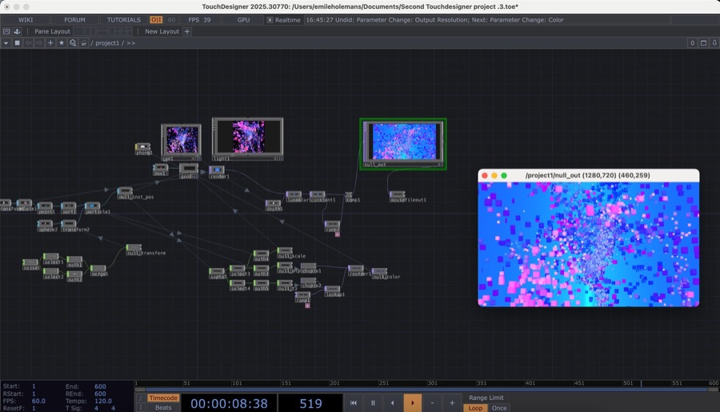

# Hi, I'm Emile 👋

Software developer in Madrid. I build web, 3D and AI products, from the first idea to a working product people use.

---

## About me

- 🎓 Master's in **Computer Science & Digital Innovation** at **IE University**, Madrid (until July 2027)
- 🏢 Co-founder of **[Mule Digital](https://mule-digital.com)**, a web studio: 20+ paid websites for businesses in Belgium, the Netherlands and the US
- 🎮 Background in **game development in C#** with Unity
- 🎧 I produce music, so a lot of what I build has sound in it
- 🧭 Heading towards **Forward Deployed Engineer / AI Solution Architect** roles in the creative industries

---

## Tech stack

**Languages** 

**Frameworks & libraries** 

**Tools & platforms** 

---

## Projects

| | |
|:--|:--|
|  | **[Pathout](https://xcessiveemile.github.io/projects#pathout)** · evacuation system Sends each person in the 35-floor IE Tower their best way out and shows the warden who is not yet out. I lead core development: the 3D simulation and the platform. TypeScript · React · three.js · Cloudflare Workers |
|  | **[Deeptune](https://xcessiveemile.github.io/projects#deeptune)** · music marketplace A curated direct-to-fan marketplace where artists keep the full listed price, with walkable 3D studio rooms. Bachelor thesis, cum laude. TypeScript · Next.js · React Three Fiber · Stripe |
|  | **[PyLevels](https://pylevels.pages.dev)** · learning game Learn Python by typing real code, level by level, with an AI tutor that nudges without giving the answer away. Free to play in the browser. Python · JavaScript · Pyodide |
|  | **[ClipMonster](https://xcessiveemile.github.io/projects#clipmonster)** · video studio Spots what is trending in a niche, turns it into a blueprint and produces an original short video, all on my own machine. TypeScript · Next.js · SQLite · FFmpeg |
|  | **[Grainfield](https://xcessiveemile.github.io/projects#grainfield)** · audio plugin A granular sampler for Ableton Live: load a sample and watch grains rise off the waveform. Audio DSP · Ableton Live |
|  | **[Boogi](https://xcessiveemile.github.io/projects#boogi)** · mobile app, internship Find gigs, book talent, get paid. I worked on the Flutter frontend. Dart · Flutter |
|  | **[Mule Digital](https://mule-digital.com)** · web studio, co-founder Websites, branding and digital strategy for small and rural businesses, plus a client portal and SEO tooling. Web · Branding · SEO |
|  | **[Experiments](https://xcessiveemile.github.io/projects#touchdesigner)** · visuals and 3D TouchDesigner particle systems, Unity worlds in C#, and Arduino lamps. C# · Unity · TouchDesigner · Arduino |

Project source code is private. Happy to walk you through any of it.

---

## Contact

Open to 2027 graduate programmes and internships.
