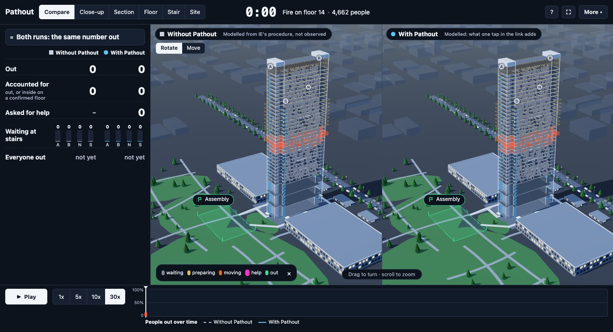
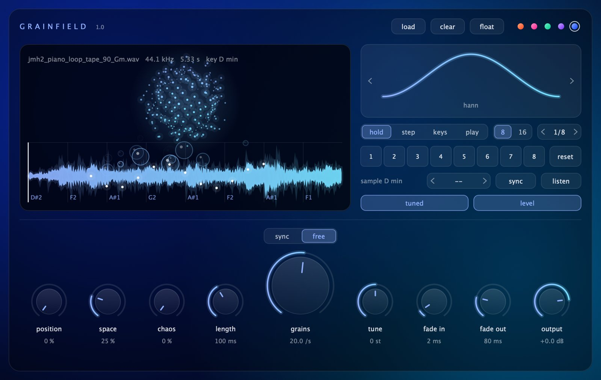
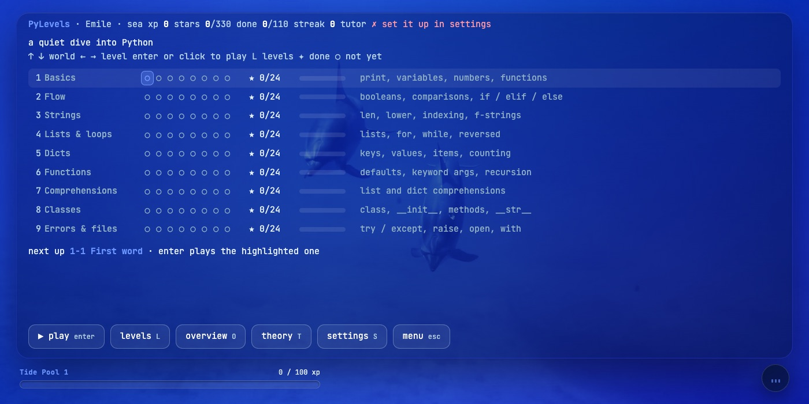
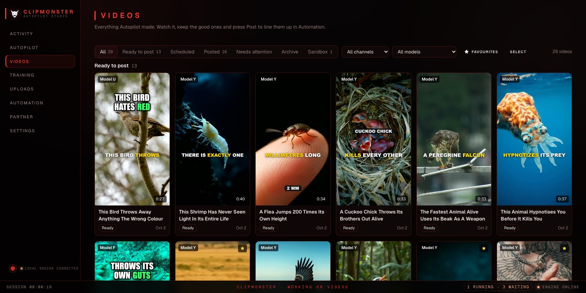
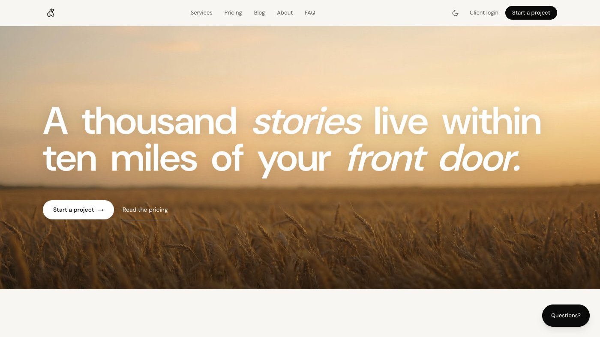

  

  
  
  
  

---

### hey, I'm Emile 👋

I build web, 3D and AI products, and I build them fast: a music marketplace with walkable 3D studio rooms, an evacuation system for a 35‑floor tower, a granular sampler plugin.

- 🎓 Master's in **Computer Science & Digital Innovation** at **IE University**, Madrid (until July 2027)
- 🏢 Co‑founder of **[Mule Digital](https://mule-digital.com)**: 20+ paid websites for small businesses in Belgium, the Netherlands and the US
- 🎧 I produce music, so a lot of what I make ends up sounding like something
- 🧭 Heading toward **Forward Deployed Engineer / AI Solution Architect** roles in the creative industries: taking AI from a demo to a system people use

---

### ✦ selected work

<table>
<tr>
<td width="50%" valign="top">

<h4>Pathout</h4>
Evacuation for the IE Tower in Madrid, 35 levels, four stairs. Each person gets their best way out; the warden sees who isn't confirmed out yet, floor by floor. I lead core development: the 3D simulation that evacuates the tower with and without Pathout, and the site that ties it all together.
  
<code>three.js</code> <code>TypeScript</code> <code>Cloudflare Workers</code>
 
<a href="https://pathout.pathout-hub.workers.dev">live site</a> · <a href="https://pathout.pathout-hub.workers.dev/apps/simulation/">simulation</a> · 🔒 source private
</td>
<td width="50%" valign="top">

<h4>Deeptune</h4>
A curated direct‑to‑fan music marketplace. Every release is picked by a person and sold straight to listeners, and artists keep the full listed price. Taken from artist research to a working MVP with walkable 3D studio rooms. Bachelor thesis, <i>cum laude</i>.
  
<code>Next.js</code> <code>React</code> <code>three.js</code>
 
<a href="https://deeptune.eu/">deeptune.eu</a> · 🔒 source private
</td>
</tr>
<tr>
<td width="50%" valign="top">

<h4>Grainfield</h4>
A granular sampler plugin for Ableton Live. Load a sample and watch grains rise off the waveform. Five colour themes, because a plugin should look like it sounds.
  
<code>C++</code> <code>JUCE</code> <code>DSP</code>
 
<a href="https://xcessiveemile.github.io">see it on my portfolio</a>
</td>
<td width="50%" valign="top">

<h4>PyLevels</h4>
A calm desktop game that teaches Python by typing real code, level by level, with underwater and outer‑space scenery. Nine worlds, flashcards, and an AI tutor (Claude, Gemini or a local model) that nudges without giving the answer away.
  
<code>Python</code> <code>desktop</code> <code>LLM tutor</code>
 
<a href="https://pylevels.pages.dev">site</a> · 🔒 source private
</td>
</tr>
<tr>
<td width="50%" valign="top">

<h4>Boogi</h4>
Find gigs, book talent, get paid. I worked on the Flutter frontend during my internship.
  
<code>Flutter</code> <code>mobile</code>
 
<a href="https://www.weareboogi.com/">weareboogi.com</a>
</td>
<td width="50%" valign="top">

<h4>ClipMonster</h4>
A local trend‑to‑video engine: finds trending Shorts in a niche, turns them into blueprints, helps make <i>original</i> videos from them and queues uploads. Every source has to pass a licence check, and nothing goes out until you press Confirm.
  
<code>TypeScript</code> <code>ffmpeg</code> <code>whisper.cpp</code> <code>YouTube API</code>
 
🔒 source private · demo on request
</td>
</tr>
<tr>
<td width="50%" valign="top">

<h4>Mule Digital</h4>
The studio I co‑founded. Websites, brand and digital strategy for small and rural businesses, plus a client portal and SEO tooling.
  
<a href="https://mule-digital.com">mule-digital.com</a>
</td>
<td width="50%" valign="top">

<h4>Audiovisual experiments</h4>
TouchDesigner particle systems, Unity worlds (including replicating a movie scene), Arduino lamps and physical objects. Things that started as a question I wanted to answer with my hands.
  
<code>TouchDesigner</code> <code>Unity</code> <code>Blender</code> <code>Arduino</code>
</td>
</tr>
</table>

more on <a href="https://xcessiveemile.github.io">xcessiveemile.github.io</a>

---

### ✦ toolbox

**build**&nbsp;

**create**&nbsp;

**ship with**&nbsp;

---

  open to <b>2027 graduate programmes and internships</b> · say hi on <a href="https://www.linkedin.com/in/emileholemans/">LinkedIn</a>

